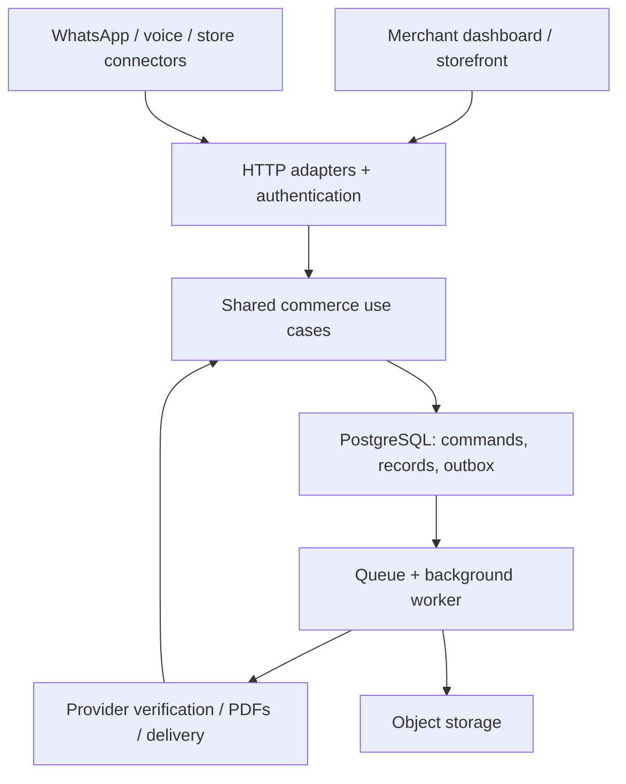

# Kora commerce MVP and long-term backend architecture

Updated: 16 October 2026. Status: implementation blueprint and proposed technical baseline; the commerce backend has not yet been implemented. The marketing site and its animated stock/payment flows are simulations.

This is the current product and backend planning document. It supersedes the WhatsApp-only architecture and conversation-based commercial assumptions in `architecture.md` and `pricing-model.md`. Product scope below reflects the ecosystem direction discussed with Vincent; specific implementation choices, operational targets and rollout gates are recommendations, not claims of an existing deployment.

## 1. Product destination and boundaries

Kora is one commerce backend for a merchant's inventory, products, customers, orders, payments and receipts. A merchant dashboard, Kora storefront, WhatsApp assistant and physical sales desk use the same records and commands. Later voice and existing-store integrations are additional channels, not separate stock systems.

The first customers are Nigerian businesses selling countable physical products, online, in person or both. Recruit 3–5 merchants, choose one retail category and one payment provider, begin with one location per merchant, import a catalogue and verify opening physical stock. Correct records and a complete order-to-receipt workflow are the pilot's primary value.

### Scope and release order

| Release | Deliverables | Explicit boundary |
|---|---|---|
| MVP: commerce foundation | Merchant accounts, staff roles, branding, products/SKUs/variants, CSV import/export, opening counts, receiving, adjustments, movement history, reservations/expiry, low-stock thresholds, basic supplier/cost records, merchant-created orders, walk-in sales, fulfilment, cancellation/return records, Paystack verification, branded PDFs, manual WhatsApp sharing and basic reports | One location per merchant; NGN; countable units; internet required for committed stock operations |
| Next: Kora storefront | Published catalogue, product pages, templates, variant selection, cart, checkout, customer contact/delivery details, shared stock and order status | A focused shop, not a general drag-and-drop website builder or marketplace |
| Next: official WhatsApp automation | Merchant onboarding, product questions, order drafting/confirmation, payment messages, document delivery, delivery tracking and human handover | Manual sharing is a separate MVP capability; no personal-chat scraping or assumed access to existing numbers |
| Later: assisted voice notes | Transcription, catalogue matching, clarification, order readback/confirmation | Language and accent coverage must be evaluated; extraction cannot approve prices or stock |
| Later: selected store connectors | Shopify/WooCommerce adapters, catalogue mappings, external-order ingestion and stock synchronisation | Explicit inventory authority, compensation for stale external checkouts and connector-specific approval/access |
| Later: inbound AI calling | Telephony/WhatsApp calling adapter where eligible, live catalogue tools, confirmed order capture, human handover | Separate realtime runtime, provider access and usage pricing; no outbound availability assumed |
| Expansion: deeper operations | Multiple locations/transfers, supplier purchase orders, barcode workflows, bundles, batches/expiry, serials and richer reports as validated | These are potential extensions, not all promised for the first release |

Partial payments, overpayments, disputes and late funds must be visible in MVP exception handling; fully automatic resolution is not required. Refund requests can be handled manually through the provider during the pilot, but their outcomes must be reconciled in Kora. Do not expose a working refund button until execution and reconciliation are implemented.

## 2. Architecture decisions

| Decision | Proposed baseline | Reason and future path |
|---|---|---|
| Shape | Modular monolith with separate web/API and worker processes | Cheap to operate and one transaction boundary; extract a service only when measured needs justify it |
| Product app/API | Next.js App Router, TypeScript, Node runtime | Dashboard and HTTP adapters in one application; core use cases stay outside framework handlers |
| Database | Supabase-managed PostgreSQL | Relational records, constraints, transactional inventory commands and tenant-scoped access |
| Identity | Supabase Auth | Staff login and session verification; business membership/permissions remain Kora-owned |
| Files | Supabase Storage | Public approved product images; private receipts/imports and controlled access |
| Jobs | PostgreSQL transactional outbox, Supabase Queues/pgmq and Node worker | Durable asynchronous work without a separate Redis dependency at pilot scale |
| Payment provider | Paystack adapter first | Server-verified funds tied to merchant/order references; add Monnify/Flutterwave only after merchant need and access are established |
| Validation | Shared TypeScript schemas, e.g. Zod | Validate requests at the boundary and tool calls using the same contracts |
| Database access | Typed SQL via one small adapter; versioned SQL migrations/functions | Keep transactional domain rules explicit; an ORM is optional, not an additional architectural requirement |
| PDF | Code-generated document, e.g. pdf-lib, in the worker | Avoid a browser-rendering service initially; immutable order/payment snapshots supply content |
| Hosting | Managed Node web service plus worker, near the chosen database region | Docker-compatible deployment; no required serverless-only behaviour or reliance on process memory |
| Marketing site | Existing Astro project | Preserve the approved design; do not rewrite it just to introduce the product app |

Keep vendor-specific code behind adapters. PostgreSQL records and SQL migrations are portable, but Auth, Storage and queue APIs still create migration work; this is not a claim of zero lock-in. Pin supported Node/package versions at implementation and verify provider limits before deployment.

## 3. Runtime topology



The diagram shows logical dependencies, not independently deployed microservices. In the pilot there are two application processes and one managed database. The worker uses application commands when applying verified results. Realtime updates and storefront caches are projections; only a committed database command grants inventory.

Long-running PDF work, provider reconciliation and retries do not run inside a browser request or a framework `after` callback. Those jobs survive web restarts. A future voice gateway can maintain streaming connections separately while using the same HTTP command layer.

## 4. Code organisation and dependency rules

Proposed eventual repository layout; do not move the current marketing source until its build and handoff remain reproducible:

```text
apps/marketing/             existing Astro site, moved only deliberately
apps/commerce/             Next.js dashboard, storefront, HTTP endpoints
apps/worker/               queue consumers and scheduled reconciliation
packages/core/             use cases, domain types, permissions, invariants
packages/contracts/        validated commands, responses, versioned events
packages/database/         SQL access, generated types, transaction adapter
packages/integrations/     payments, storage, messaging, ecommerce adapters
packages/documents/        receipt/invoice layouts and formatting
supabase/migrations/       schema, grants, RLS and atomic database commands
supabase/tests/            constraint, RLS and concurrency integration tests
docs/                      architecture, operations and decision records
```

HTTP handlers authenticate, validate and call use cases. They do not contain a second version of inventory arithmetic. Workers and internal server rendering call the same use cases directly; external channels use versioned HTTP contracts. Core modules do not import React, Next.js request objects, a payment SDK or an LLM SDK. Cross-module writes go through a named command; SQL migrations define the atomic implementation for commands spanning stock/order/payment records.

## 5. Domain modules

| Module | Owns | Core commands / outputs |
|---|---|---|
| Merchant access | Businesses, memberships, roles, branding, feature flags | Create merchant, invite/revoke staff, authorise operation |
| Catalogue | Products, variants, SKUs, images, prices, publication | Import catalogue, edit variant, publish product |
| Inventory | Locations, balances, movements, counts, reservations | Receive, adjust, reserve, release, consume hold, reconcile |
| Orders | Customer association, agreed items/prices, lifecycle | Draft, confirm, amend, cancel, fulfil |
| Payments | Connections, attempts, verified funds, allocations, refunds | Initialise, verify, allocate, reconcile, request/refund outcome |
| Documents | Numbering, immutable snapshots, PDF jobs/access | Issue invoice, issue receipt, regenerate same document version |
| Customers | Merchant-scoped contacts, addresses, channel identifiers | Resolve contact, update authorised details, link order |
| Integrations | External IDs, webhook inbox, outbound deliveries | Ingest, deduplicate, map, deliver, retry |
| Reporting | Derived operational views and cost/margin estimates | Sales, unpaid balances, stock history, costs, exports |
| Platform operations | Audit, jobs, entitlement usage, support actions | Monitor exceptions, enforce limits, replay jobs, scoped support |

Suppliers are basic merchant-scoped reference records in MVP. Full purchasing is a later module. Customer purchases and Kora subscription billing are separate domains and must never share payment reference namespaces or settlement assumptions.

## 6. Tenant isolation, identity and permissions

A merchant is the tenant. Users can belong to multiple merchants; a selected business ID is not proof of access. Validate the signed session server-side, then check the active membership and permission for every merchant command. Do not accept an actor ID, role, total or merchant ownership claim merely because it was in the submitted JSON.

Proposed roles:

| Role | Permission boundary |
|---|---|
| Owner | Business settings, staff, provider connection, exports and sensitive approvals |
| Manager | Catalogue, receiving, reasoned stock adjustments and order exceptions, subject to settings |
| Sales staff | Create orders, record cash with audit, fulfil permitted orders; no secret access or owner privileges |
| Viewer / accountant | Explicit reporting/export permissions; cost visibility is separate from general stock access |
| Worker | Narrow internal commands tied to validated events/jobs; not a merchant user role |
| Customer / storefront visitor | Published catalogue and their specifically authorised checkout/order/receipt access only |

Every tenant table carries `merchant_id`. Use composite unique keys and foreign keys such as `(merchant_id, variant_id)` so a row cannot point into another merchant's order, product or location. Tenant checks also apply to background jobs, storage objects, caches and exports.

Enable and test RLS for exposed tables. Avoid granting browser roles direct balance, movement, payment or order-transition writes. Public catalogue reads use an allowlisted projection without purchase costs, customer data or internal stock history. Staff cost visibility requires column/view-level controls as well as row filtering.

Critical commands run through restricted transaction functions: revoke default public execution, use a fixed/empty search path and fully qualified relations, check `auth.uid()` membership and permission inside any privileged user-facing function, and forbid direct sensitive-table DML. Internal worker functions have separate grants and trusted event inputs. A `security definer` function or service role can bypass ordinary RLS, so neither is treated as automatic authorisation. Privileged worker access must not become a generic pass-through for browser requests.

For SQL connections, use a pooler compatible with the chosen transaction/driver mode. Never leave user identity in reusable session state; any trusted claim context is transaction-local. Prefer the Supabase user-JWT RPC path for staff commands initially and separate server-only paths for workers. Verify connection/TLS settings and budget total web-plus-worker connections before scaling.

## 7. Data model and invariants

Use UUID internal identifiers and separate human-facing order/invoice/receipt numbers. Store UTC timestamps and render in the merchant's timezone (Africa/Lagos initially). Monetary amounts are integer minor units (kobo for NGN), with explicit currency; calculate discounts/delivery/tax components server-side using defined rounding. Do not add a tax rate implicitly or claim statutory compliance from the receipt template.

MVP quantities are integer units. Capture `unit_code` and SKU/pack descriptions now; fractional/weight quantities and pack conversion require an explicit migration, precision/rounding policy and tests later. Snapshot the sold description, SKU, unit and price so catalogue edits cannot rewrite past sales.

| Tables | Key fields / rules |
|---|---|
| `merchants`, `memberships`, `invites`, `merchant_settings` | Membership unique per user/business; invite tokens expire; branded identity and timezone |
| `products`, `variants`, `product_media` | Unique SKU per merchant; active/archive status; variant metadata, sell price/currency; archive referenced variants rather than deleting history |
| `locations`, `inventory_balances` | Unique business/location/variant; `on_hand >= 0`, `reserved >= 0`, `reserved <= on_hand`; optional reorder threshold |
| `stock_movements`, `stock_counts`, `suppliers` | Signed physical delta, reason, actor/source, operation ID and cost snapshot; opening stock is a movement |
| `reservations`, `reservation_lines` | Order/location/variant, expiry, held/consumed/released quantities, lifecycle and audit history |
| `customers`, `customer_addresses`, `customer_channel_ids` | Tenant-scoped identity; normalised phone/email where present; payer identity is not automatically the customer |
| `orders`, `order_items`, `order_events` | Source channel, expected version, commercial state, immutable agreed item snapshots and totals |
| `fulfilments`, `fulfilment_items`, `returns`, `return_items` | Per-item picked-up/dispatched/returned quantities; enforce not more than eligible quantity |
| `payment_connections`, `payment_attempts`, `payments`, `payment_allocations` | Credential references, provider mode/account, reference, gross amount/currency, distinct financial state and allocated amount |
| `refund_requests`, `refunds` | Requested/approved/submitted/pending/succeeded/failed; verified refund outcomes linked to original funds |
| `documents`, `document_snapshots`, `document_access_tokens` | Per-merchant document number, version, private object key, content hash, render status and scoped access |
| `webhook_inbox`, `idempotency_records`, `outbox_events` | Authenticated inbound event evidence, command dedupe and transactionally recorded work |
| `delivery_attempts`, `integration_connections`, `external_mappings` | External message/order IDs, mapping version, delivery outcome and connector health |
| `audit_events`, `usage_events`, `entitlements` | Sensitive actions, cost/volume attribution, approved feature/plan limits |

Create MVP tables as needed by working flows. Later tables such as connector mappings and subscription catalogues are design contracts, not a reason to build unused schemas immediately. Index hot paths by merchant/status/time, merchant/SKU, balance key, reservation expiry, provider reference and pending outbox state. Use a deterministic tie-breaker for cursor pagination.

## 8. Inventory ledger and cost model

`available = on_hand - reserved`. Default: no negative stock, no backorders and one fulfilment location per order in MVP.

| Event | Physical on hand | Reserved |
|---|---:|---:|
| Receive 10 units | +10 | unchanged |
| Confirm an order for 2 | unchanged | +2 |
| Verify full payment | unchanged | unchanged |
| Pick up / dispatch 2 | -2 | -2 |
| Cancel unpaid order / expire unpaid hold | unchanged | release remaining hold |
| Accept a resellable return | +accepted quantity | unchanged |
| Refund without returned goods | unchanged | unchanged |
| Record damage | -approved quantity | unchanged; resolve affected holds first |

`stock_movements` is append-only application history, not a claim of tamper-proof storage against a database administrator. Each physical change writes a movement and balance update in one transaction. Corrections create compensating entries with a reason. Reservation entries track commitments separately from physical movement. Run reconciliation to check opening plus movement deltas against balances and active unconsumed holds against `reserved`; discrepancies create an incident/review task rather than silently overwriting data.

Cycle counts capture counted versus expected quantities and an approved adjustment. Do not allow an adjustment to bring on-hand below current holds without resolving the affected orders. Record a walk-in sale/payment declaration/fulfilment atomically so it cannot bypass existing reservations.

Basic costs: record unit purchase cost on receiving; proposed MVP valuation is moving weighted average per variant/location. Define treatment for opening stock, landed costs and unknown costs; do not substitute zero for unknown cost. Fulfilment snapshots the chosen unit cost for indicative cost-of-goods reporting. Resellable returns refer to original fulfilment cost. Changing valuation methods later requires an explicit migration/revaluation decision. Reports are operational estimates, not statutory accounts or complete net profit.

## 9. Transactional commands and concurrency

Every critical mutation needs a caller-provided/generated idempotency key scoped by merchant and command, a validated payload hash, and a stable result. Reusing a key with a different payload is an error. Financial and stock uniqueness constraints remain durable even if short-lived request-response dedupe records are eventually pruned.

Proposed `confirmOrder` transaction:

1. Authorise the actor, validate expected order version and claim the idempotency record.
2. Lock the order (if present), then the required balance rows in deterministic `(location_id, variant_id)` order.
3. Calculate canonical prices/totals and check all requested quantities against availability.
4. Save order/items, create the holds and increase reserved quantities.
5. Append order/audit events and the relevant outbox records; persist the result; commit.

All items succeed together or the transaction rolls back. Pre-create balance rows when variants are stocked or handle creation with a unique-key-safe insert before locking. Catch bounded lock timeouts, deadlocks and transaction conflicts; retry a small bounded number of times with jitter and the same idempotency key. A loser for the last unit receives `INSUFFICIENT_STOCK`, not a successful order followed by an invented adjustment.

Use a documented lock hierarchy for every payment, cancellation, expiry, fulfilment and adjustment operation. Proposed order: idempotency record, order, relevant balance rows sorted, reservation/fulfilment rows. Multi-order work locks order IDs in a consistent order or splits into small commands. Do not hold a database transaction while calling Paystack, an LLM or a messaging API.

`fulfilOrder` validates remaining paid/approved quantities, then consumes holds and deducts physical stock in the same transaction. `cancelOrder` releases only unconsumed holds. `amendOrder` checks order version, recalculates totals and changes holds atomically; paid-order value changes become an explicit balance/refund exception. A multi-step sequence of separate browser database calls is not an acceptable implementation of these commands.

## 10. Order, payment and fulfilment states

Keep separate state machines rather than one overloaded `status`:

| Dimension | Representative states |
|---|---|
| Commercial order | draft, confirmed, cancelled, closed; `needs_review` exception flag |
| Payment attempt | created, initialising, pending, succeeded, failed, unknown |
| Order payment summary | unpaid, partially_paid, paid, overpaid, partially_refunded, refunded, disputed/review |
| Fulfilment | unfulfilled, partially_fulfilled, fulfilled, partially_returned, returned |
| Reservation | active_unpaid, active_paid, partially_consumed, consumed, released, expired |
| Document | queued, rendering, ready, failed, superseded |

Transition guards derive summaries from lines, valid allocations and verified events; a client cannot simply PATCH an order to paid. Permit partial fulfilment by recording exact line quantities. For the pilot, deposits/partial payments keep an exception visible and require an explicit merchant decision; do not automatically dispatch a partly paid order.

Proposed unpaid hold duration is configurable, initially 15 minutes, aligned with the payment flow. A worker finds due orders and calls the locked expiry command. It rechecks financial/hold state in the transaction. Paid holds do not expire automatically. If a verified payment arrives after a hold was released, try to reserve again atomically; if stock is unavailable, keep funds recorded and mark `paid_needs_review`, then arrange an approved alternative or refund. Never discard the payment or promise unavailable goods.

A partially fulfilled order can only cancel remaining quantities. A return needs inspection/disposition: resellable, damaged/quarantine or rejected. Only the resellable quantity increases saleable on-hand stock. Financial refund decisions remain separate.

## 11. Payment architecture and funds ownership

Each merchant needs an authorised provider setup. Decide approved per-merchant credentials versus an approved platform/subaccount/partner arrangement before live onboarding. Do not route every merchant's sales into an ordinary Kora bank account or assume a provider supports every desired marketplace flow. Provider onboarding/KYC, supported payment methods, settlement and refunds are external launch dependencies.

`PaymentProvider` adapter operations: initialise payment, verify transaction, validate webhook, query refunds and (when implemented/approved) request refund. Keep provider-native payloads and IDs as evidence without leaking secrets. Bind each attempt to a known provider connection, test/live mode, merchant, order, expected gross amount and currency. Use globally unique references; persistent customer virtual accounts identify a customer and do not necessarily identify one invoice.

Flow:

1. Commit the order/reservation and payment intent.
2. Initialise provider checkout outside database locks; persist its reference/result. If the request times out ambiguously, look up the attempt/reference before creating another charge.
3. Accept provider callbacks only as navigation hints. The server verifies financial outcomes.
4. Webhook handler reads bounded raw bytes, resolves the authorised signing configuration and validates the signature (Paystack: HMAC-SHA512 over raw payload).
5. Persist the validated event in the inbox and transactionally schedule verification, then return success promptly. Invalid signatures fail; storage failure must not be acknowledged as successfully saved.
6. Worker queries the verification API, checks actual transaction status, gross amount/currency, reference and recipient/provider-account binding, then applies the result atomically.
7. A unique `(provider, connection/mode, transaction_id)` prevents financial duplication. Validate that the chosen provider transaction-ID scope matches this constraint.
8. Record allocations and an outbox document job in the same transaction as the financial update.

Do not assume every provider event has a unique delivery ID. Store event type, available external ID and a payload hash for delivery dedupe; business-level transaction constraints are the final defence. Bind tenant identity from trusted connection/reference mappings, not a merchant ID supplied in arbitrary webhook metadata.

Reconcile pending/unknown attempts and refund/reversal outcomes periodically. Amount mismatches, unidentified transfers, third-party payer names, partial/overpayments and disputes enter review. Maintain an append-only payment/allocation history with corrective entries so a change in financial status can be explained. Separate gross customer funds, provider fees, refunds and net settlement: paying an order does not mean payout settlement is complete or irreversible.

Cash is staff-declared receipt of money with actor/time; label it distinctly from provider verification. A manually reconciled bank transaction needs recorded evidence and authorised review, never an automatic inference from OCR.

## 12. Durable events, queues and scheduled work

Business transactions append `outbox_events` containing event ID, schema version, merchant, aggregate ID/version, correlation/causation ID and minimal payload. Proposed events include `order.confirmed.v1`, `inventory.reserved.v1`, `payment.verified.v1`, `fulfilment.recorded.v1`, `receipt.requested.v1` and `inventory.low_stock.v1`. Do not enqueue directly from a request before the database commit.

A dispatcher claims unsent outbox rows and publishes queue jobs. Prefer same-database atomic outbox-to-pgmq enqueue/mark operations; if the library path cannot share a transaction, allow replay and deduplicate consumers by event ID. Keep queue APIs internal. Acknowledging the outbox record before durable enqueue is forbidden.

Workers claim with a visibility lease, heartbeat or suitably sized lease for long jobs, acknowledge after durable success, and retry transient failures with exponential backoff/jitter. Bound attempts (initial proposal: 5, configurable per job) and move exhausted/permanent failures to a dead-letter/review queue. Persist provider request IDs and delivery attempts before external sends where possible. A crash after an external send can still cause ambiguity: consult provider status/idempotency facilities before replay. Do not promise exactly-once WhatsApp delivery merely because the queue has a visibility window.

Schedules: unpaid-hold expiry every minute; pending payment reconciliation on an adaptive cadence; outbox dispatch continuously; low-stock transition checks; daily ledger/hold reconciliation and operational reports; retention cleanup after policy approval. Each scheduled run has an idempotency/run key. A worker restart catches up from durable state, not missed in-memory timers.

PDFs, exports and receipt retries cannot block payment ingestion. Start with bounded concurrency and separate logical queues; later separate worker pools when PDF jobs or a noisy merchant delay critical reconciliation. Coalesce low-stock alerts and suppress repeat reminders to avoid unbounded provider costs.

## 13. Documents, sharing and file access

An invoice is a payment request; a receipt records money received. Issue documents from saved item/merchant/payment snapshots with immutable numbering, amount/currency, receipt/invoice/order IDs, quantities, balances, payment method, provider reference and relevant time. Preserve customer name separately from payer name. Cash and manual confirmation labels remain explicit. Do not imitate a bank-issued receipt.

Generate the PDF in a background job, store it privately, then mark that version ready with checksum and object key. Retry render failures without generating a new receipt number. If issued content needs correction, create a new version/corrective document; do not silently mutate the historical snapshot. A refund/reversal changes the live receipt-status view without rewriting evidence of the original receipt of funds.

Merchant downloads require membership/permission and short-lived signed access. For MVP manual WhatsApp sharing, provide a merchant-initiated message containing an opaque receipt link, plus download and optional OS file-share support where available. A `wa.me` text link does not attach a PDF automatically. Disclose that the merchant still sends it. The customer link is a revocable high-entropy bearer token, stored hashed, scoped to one document and expiry (proposed seven days), with no personal data in the URL. Decide whether to require additional customer verification for sensitive receipts. Avoid logging tokens or retaining public signed storage URLs in order records.

Product photos may be publicly published after validation. Imports, customer documents and receipts are private. Enforce byte/type/dimension limits, verify MIME/content rather than filename alone, isolate object paths by merchant and serve downloads safely. Confirm separate object backup/export coverage; database backups alone are not evidence that file bytes can be restored.

## 14. API and command contracts

Start with JSON HTTP `/api/v1`, schema validation, structured errors, correlation IDs, tenant/role authorisation, bounded input sizes and cursor pagination. Contract changes are versioned; AI tools and integrations call these same operations. Return canonical totals and resulting resource versions. Use an `Idempotency-Key` for committing/retrying commands and `expectedVersion` for concurrent edits.

| Endpoint / command family | Permission and invariant |
|---|---|
| `GET /merchants`, `POST /merchants`, membership/invite endpoints | Authenticated identity; owner-only staff/admin changes |
| `GET/POST /products`, variant edits, `POST /imports` | Catalogue permission; merchant-scoped SKU; import preview before commit |
| `GET /inventory`, `GET /stock-movements` | Scoped reads with separate cost permission |
| `POST /inventory/receive`, `/adjust`, `/counts` | Reasoned, audited transaction; never generic balance PATCH |
| `POST /orders`, `/orders/:id/confirm`, `/amend`, `/cancel` | Shared total/reservation rules and version/idempotency checks |
| `POST /orders/:id/fulfilments`, `/returns` | Eligible quantities and hold/physical changes atomic |
| `POST /orders/:id/payment-attempts` | Order state and connected merchant account validated |
| `POST /webhooks/paystack/:connectionRoute` | Signature-authenticated raw event; route is not a secret or sufficient authorisation |
| `GET /orders/:id`, `/documents/:id/download` | Member permission or explicitly scoped customer credential |
| `POST /documents/:id/share-link`, `/revoke` | Explicit merchant sharing, token scoping and audit |
| `GET /reports/*`, `POST /exports` | Reporting permission, bounded range/async exports |
| Later `/storefronts/:store/*`, `/integrations/*` | Published projection or narrowly scoped connector credentials |

Example errors: `INSUFFICIENT_STOCK`, `ORDER_VERSION_CONFLICT`, `PAYMENT_PENDING`, `PAYMENT_AMOUNT_MISMATCH`, `PAYMENT_REQUIRES_REVIEW`, `PERMISSION_DENIED`, `IDEMPOTENCY_KEY_REUSED`. Use appropriate HTTP codes and avoid leaking whether another tenant's resource exists. Rate-limit by IP, merchant, user and provider connection as appropriate. MVP limits must work across application replicas; do not rely exclusively on in-memory counters.

## 15. Storefront and ecommerce growth path

The storefront's public hostname/slug resolves to a server-controlled merchant identity. Never trust a submitted tenant ID to choose prices or access another store. Cart contents are proposals; checkout reloads active variants, stock, prices, discounts and delivery charges from authoritative rules before reserving.

Cache public catalogue pages with merchant-scoped keys and invalidate on changes. Cached stock badges and realtime updates are advisory; checkout always rechecks. After login or role changes, private page/query caches must not cross users or merchants. Customer order access requires verified ownership or a narrowly scoped checkout token, not knowledge of an order UUID.

For external stores, record external product/variant/order mappings and inbound event versions. Choose one inventory authority per connection; initially propose Kora as the authority for Kora-managed inventory. External platforms can sell against stale projections even when Kora's local transaction is correct. Handle shortages as visible exceptions, use safety buffers where appropriate and document limits rather than promising perfect cross-platform prevention. Deduplicate imported orders and suppress outbound-update feedback loops. Reconcile periodically and show connector health/staleness. Begin with one adapter; do not write simultaneously into two unrelated stock masters.

## 16. WhatsApp, AI and voice boundaries

MVP merchant entry/manual sharing must stand alone. Official WhatsApp work adds authorised number/account onboarding, inbound signature verification, message-ID dedupe, consent/contact policies, template/service-window rules, delivery receipts and agent-to-human handover. Confirm existing-number/coexistence eligibility with the chosen official provider; never assume an installed consumer/Business App number can simply be read.

A conversation/session belongs to a merchant connection and customer channel ID. Store minimum context and tool audit; bind every tool to merchant permissions and the current order version. AI output is untrusted input validated against shared schemas. Tools can search published products, propose an order, ask clarifying questions and request allowed commands. Prices, fees, stock arithmetic and paid status come from the backend. Customer messages and uploaded documents cannot override system permissions or authorise refunds. OCR is an extraction aid, not proof of payment.

Add voice-note transcription behind an adapter and evaluate local units, names, accents and languages with consented test material. Do not claim coverage before measurement. Require confirmation of the selected variants, quantities, address and total.

Live calling needs a streaming-capable gateway and bounded concurrent sessions; do not force it into short-lived Next.js serverless handlers. It reuses commerce APIs, with session idempotency, interruption/cancellation handling, confirmation gates, timeout/human fallback and per-minute cost attribution. Verify provider/country/account eligibility at that stage. Disclose automated assistance and establish recording/retention controls before enabling recording. No card secrets or payment credentials are collected in ordinary chat or AI prompts; send the supported checkout flow.

## 17. Multi-location and specialist inventory path

Locations exist in the schema from day one, but initial entitlements allow one active stock location. Later enable locations per merchant, location-aware availability and routing. Transfers reserve at origin, dispatch into in-transit state and receive at destination through auditable events; avoid claiming goods are physically in both locations. Define returns routing and partial-transfer loss explicitly.

Potential later additions: purchasing/receiving discrepancies; barcode-to-variant mappings; fractional units with exact conversion; bundle component reservations; batch/expiry allocation; unique serial tracking; stocktake workflows and reorder suggestions. Each must extend the inventory command interface and ledger rather than create hidden stock counters. Expiry, serials and recipes are feature work, not properties magically supplied by PostgreSQL. Merchant sectors requiring them cannot rely on the MVP as a complete solution.

## 18. Reporting, usage and commercial controls

Operational dashboards derive from order, fulfilment, payment/allocation and stock records. Separate ordered sales, collected cash/provider funds, outstanding balances, refunds, settlement and fulfilled cost estimates. Use indexed views/queries first; add projections or materialised summaries when measured query cost requires it. Label incomplete/unknown costs and avoid claiming profit excludes no expenses. Customer-data exports must enforce permissions and neutralise spreadsheet formula injection in text cells.

Record per-merchant orders, storage, PDF jobs, provider messages by category, AI tokens/audio minutes, voice duration and retries. Enforce atomic entitlements at command acceptance; retries/replays must not consume an order allowance twice. Keep payment reconciliation, receipt retrieval and access to existing data working when a merchant reaches a commercial limit. Define draft/void-order counting before billing; do not silently charge double for edits.

Pilot pricing remains a test: proposed NGN 5,000 for 100 orders/month, Store NGN 10,000 for 300, and Connected from NGN 20,000 with messaging allowances still to be defined. Annual comparisons are illustrative, not live billing. Do not reuse the old conversation pricing or message-free-tier pooling assumptions. Revalidate actual provider pricing and cost per completed order before publishing automated-channel allowances. Voice is a separate metered add-on later.

## 19. Deployment, environments and capacity

Development: local application/worker and Supabase local services, reproducible migrations/seeds and provider sandbox fixtures. Integration tests need real PostgreSQL, not only mocks. Staging and production use separate databases, storage, auth configuration and provider credentials. Never point an untrusted branch preview at production secrets or customer data.

Proposed pilot hosting: retained static Astro marketing host, one managed Node service for the Next.js application/API, one managed Node worker, Supabase Pro for production database/Auth/Storage/queues, and configured transactional email/SMTP for production auth. Render is a candidate for web/worker, not an already purchased commitment. Keep the Node runtime container-compatible so hosting can change without changing domain rules. Reuse the same application modules in web/worker builds; handle graceful shutdown, leases and connection pool sizing.

Choose a supported application/database region pair after measuring latency from Nigerian users and reviewing data requirements. Keep API and database near one another. Do not claim Lagos hosting or a specific residency policy before selection. Externally exposed webhooks need stable HTTPS endpoints; only ingress/API services accept public requests. Use private/internal access where available but authenticate every database/provider connection regardless of network placement.

Initial workload assumption: 3–5 merchants and modest order volume, not a promise to support 5,000 users or 1,000 simultaneous checkouts on entry compute. Test contention and latency, monitor connection usage, and scale database/worker resources from measured load. Use pooled connections and bounded workers; a queue can overload the database if concurrency is unbounded.

## 20. Security and operational data handling

Use HTTPS, server-side secrets, secure session cookies where applicable, CSRF/origin protection for cookie-authenticated mutations, explicit CORS, request limits, rate limits, dependency updates and redacted structured logs. Verify JWTs rather than merely decoding them. Require stronger verification/re-authentication for provider changes, ownership transfer and sensitive staff actions. Support operator access is scoped, time-bound and audited; never a public generic service-role console.

Keep provider credentials in a secret manager or encrypted credential records with encryption keys stored separately from the database. Log connection identifiers, never keys. Rotate credentials with an explicit signing-key transition plan. Prevent SSRF in external image/import URLs; use allowlists or controlled fetchers. Reject oversized webhooks/uploads before expensive processing. For later platform billing and integrations, separate test/live credentials and outbound destination controls.

Publish the production operator/contact details, purposes, subprocessors, regions, retention, deletion/export and incident procedures before onboarding real customer records. Retention values remain open decisions; the previous 18-month/30-day figures are not inherited commitments. Delete/minimise conversation media independently of required commercial audit history. Use synthetic/anonymised fixtures in development and obtain consent before using merchant messages for evaluation.

## 21. Observability, recovery and service targets

Structured logs carry request, merchant, command, order, payment/event and job IDs without full sensitive payloads. Metrics include API latency/errors, database lock waits/connections, oversell/negative-stock invariant violations, oldest job age, payment-verification delay, failed/duplicate webhooks, late-payment exceptions, failed PDFs, delivery failures and per-merchant cost. Logs and exception queues need authenticated operator views.

Proposed pilot alerts: any cross-tenant exposure/inventory invariant failure immediately; valid payment ingestion/storage failures; unresolved verification or receipt queues older than five minutes; reconciliation discrepancies; sustained database/worker failure. Alert thresholds are operational starting points, not customer SLAs. Track receipt generation separately from WhatsApp delivery, which depends on provider availability and customer reachability.

Proposed early targets under tested pilot load: common reads p95 below one second, order commits p95 below two seconds excluding external providers, and most receipts ready within one minute after verification. Acknowledge authenticated webhook events promptly after durable storage. Validate these with staging load tests before advertising them.

Supabase Pro's published daily database backups are a starting point. Before live trading, perform a restore rehearsal and confirm coverage of schema, auth, storage objects and secrets/configuration. Record an initial recovery objective explicitly: daily backups alone imply up to roughly a day of database loss, which may be unacceptable for stock/payments. If the pilot accepts a low-volume manual recovery window, document that agreement and rehearse provider reconciliation, exports and physical stock checks. Otherwise fund PITR/additional backups before launch. Restoration must disable outbound jobs until restored events/financial records have been reconciled, to avoid duplicate receipts or refund attempts. Select recovery-time and recovery-point targets based on the actual tested process, not an unverified uptime promise.

## 22. CI/CD, migrations and rollback

Version schema changes and transaction functions in SQL migrations. Never rely on unrecorded dashboard-only edits. Use expand/backfill/contract migrations for breaking changes; deploy code that tolerates both versions before dropping fields. Backfills are bounded, restartable and monitored. Pin event/queue schema versions and keep consumers compatible across rolling deploys.

Pull-request checks: TypeScript/contract validation; unit tests; real-Postgres migration/RLS/constraint/concurrency tests; provider fixture/adapter tests; secret/dependency checks; application build. Staging adds sandbox end-to-end checkout, failure/retry tests, auth/email and document access checks. Production deploy follows a migration review, backup/recovery check and smoke tests with feature flags. Application rollback must not require destructive schema rollback. Do not merge or deploy backend code merely because this architecture document exists.

## 23. Verification and release gates

Required behavioural tests:

- Two channels race for the last unit: only one reservation succeeds.
- A multi-item order with one unavailable SKU leaves no partial holds or order commit.
- Same command retry returns the original result; altered payload/key reuse fails.
- Cancellation, expiry and verified payment race: funds and reservations stay consistent.
- Payment arrives after sellout: recorded funds plus visible exception, no invented stock.
- Duplicate webhook/verification/refund event never double-credits funds or triggers double deduction.
- Forged callback, invalid signature, wrong merchant/provider account, currency or amount cannot mark paid.
- Partial fulfilment and repeated dispatch consume only eligible held quantities.
- A refund without return does not restock; damaged returns are not saleable.
- Cash/walk-in sales respect reservations and keep a staff declaration trail.
- Variant/price edits cannot rewrite historical order or receipt snapshots.
- Stock movements and reservation quantities reconcile to stored balances.
- Cross-merchant reads, foreign keys, commands, exports, storage links, jobs and cost fields are denied.
- Direct browser writes/RPC privilege abuse cannot bypass command guards.
- Worker crashes before/after enqueue, PDF upload or external send recover visibly without hidden financial side effects.
- Stale storefront caches, lost realtime connections and disconnected workers do not grant stock.
- Import preview validates duplicate SKUs, invalid units/prices, row limits and unsafe spreadsheet text.
- Backup restore is rehearsed, including files, recovery reconciliation and paused outbound delivery.

Release gates: working authenticated merchant setup; signed/verified provider sandbox flow; verified tenant/stock invariants; usable exception review; ready PDFs/manual share; observable failed jobs; consent/access and live provider setup; backup restore plan accepted. Then onboard a small live pilot. No live-money launch on the basis of a simulated demo.

## 24. Implementation milestones and acceptance

| Milestone | Concrete acceptance |
|---|---|
| A. Foundation | Auth, merchant membership/roles, migration pipeline, permission tests, separate staging |
| B. Catalogue and inventory | CSV preview/import, variants/location, opening movements, receiving/adjustments, reconciled balances, thresholds and basic costs |
| C. Orders | Canonical totals, atomic multi-item reservations, expiry, counter sales, cancellation, partial fulfilment and return disposition |
| D. Money and documents | Approved merchant connection path, sandbox verified payments, duplicate/late-event handling, payment allocations, PDF jobs and private manual-share access |
| E. Pilot operations | Exception screens, retries/reconciliation, usage/cost visibility, exports, restore rehearsal and live readiness review |
| F. Storefront | Published catalogue, checkout on the same commands, customer-scoped order access, stock/cache/retry tests |
| G. WhatsApp | Official onboarding/inbound/delivery adapters, policies/templates, human handover and measured messaging allowance |
| H. Extensions | Voice notes, selected store connectors, inbound calls and specialist inventory based on pilot evidence |

No calendar guarantee is attached to these milestones. Implement a usable vertical slice at each step. Advanced inventory foundations are MVP scope; voice and general warehouse/purchasing functionality are not compressed into a one-day build promise.

## 25. Cost baseline and budget controls

Prices are planning inputs checked on 16 October 2026, not a vendor quote or a total cost of business. Supabase Pro is published from USD 25/month with one entry-size project covered by included compute credit; additional projects/resources/PITR may cost more. Use free/local resources for development within their limits; do not assume free plans supply production recovery guarantees.

Managed Node web/worker compute, production email, backup/file recovery, domains, taxes and any staging resources are additional. Render's published materials identify small instances around USD 7/month each, but current plan names, workspace eligibility, limits and total charges must be verified during provisioning. An illustrative database + two small-process subtotal is about USD 39/month before all other costs. Reserve a practical initial operating allowance around USD 50–100/month for a tightly limited pilot; actual provider use and recovery choices can exceed it. This excludes development/support labour, customer-payment processing, WhatsApp messages, AI and voice usage.

Keep per-merchant cost measurement from the first automated integration. No unlimited message/voice promise, no infrastructure entitlement inferred from an auth-user quota, and no fixed-capacity claim without load tests. Add Redis, dedicated search, a warehouse or separate services only for measured bottlenecks.

## 26. Scale and service-extraction triggers

Scale vertically and improve indexes/queries first; add web replicas and worker pools when CPU, latency, queue age or availability needs justify them. Keep commands stateless, files external and sessions verified so replicas share no hidden state. Fair per-merchant queue concurrency prevents a single import or report from starving payments.

Extract the realtime voice gateway when voice is introduced, not before. Consider separating integrations when external failures or webhook volume dominate web traffic; reporting when scans affect checkout; search when PostgreSQL search/indexing is insufficient. Preserve command/event contracts and never create a second authoritative inventory database as an accidental side effect of extraction. Read replicas and analytics projections never approve reservations.

## 27. Decisions to confirm before implementation/live launch

| Decision | Working default / blocker |
|---|---|
| First merchant category | Countable retail products, one location; identify actual pilot merchants |
| Payment ownership/onboarding | Paystack first; per-merchant versus approved platform setup must be confirmed before live funds |
| Hosting/region | Managed Node app + worker near Supabase; provision after latency, budget and data review |
| Inventory unit/valuation | Integer units, explicit variants, moving weighted average; confirm whether real merchants require fractional stock or expiry immediately |
| Deposits, credit and refunds | Visible review workflow; no automatic partly paid fulfilment; provider-dashboard refunds until the execution adapter is validated |
| Delivery fees/tax treatment | Explicit merchant-configured charges, server calculated; no universal inferred tax rule |
| Public receipt access | Scoped revocable expiring bearer links proposed; confirm customer verification needs |
| Recovery and retention | Agree restore/reconciliation tolerance, file coverage, retention and privacy documentation before live onboarding |
| Pilot commercial terms | Proposed prices/limits only; confirm inclusion, support effort and usage definitions |

These open decisions do not block schema/contract design or sandbox work. They do block any feature whose safety, price or availability depends on their answer. Resolve them at the relevant milestone, without pretending the marketing preview made them final.

## 28. References and related documents

Official documentation checked for this plan:

- [PostgreSQL locking](https://www.postgresql.org/docs/current/explicit-locking.html): transaction/row-lock primitives used by the proposed reservation design.
- [Supabase database functions](https://supabase.com/docs/guides/database/functions): function execution privileges and `security invoker`/`security definer` boundaries.
- [Supabase RLS](https://supabase.com/docs/guides/database/postgres/row-level-security): row policies and authenticated access.
- [Supabase Queues](https://supabase.com/docs/guides/queues): pgmq-based durable queues; worker/application idempotency still required.
- [Next.js backend guide](https://nextjs.org/docs/app/guides/backend-for-frontend): HTTP adapters and host-dependent long-running/WebSocket limitations.
- [Paystack webhooks](https://paystack.com/docs/payments/webhooks/) and [verification](https://paystack.com/docs/payments/verify-payments/): authenticated events and server transaction checks.
- [Supabase pricing](https://supabase.com/pricing), [Render pricing](https://render.com/pricing) and [Render compute plans](https://render.com/docs/compute-plans): provisioning inputs to recheck before purchase.

Related repository documents: `commerce-copy-and-art.md` (public proposition/preview limits); `CODEX_HANDOFF.md` on the handoff branch (source-port instructions); `architecture.md` and `pricing-model.md` (superseded historical assumptions).
